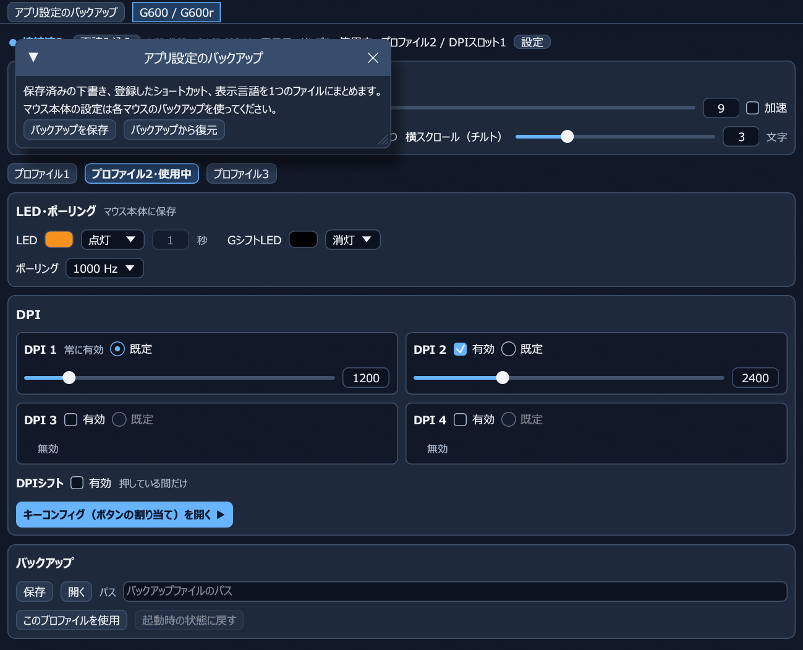
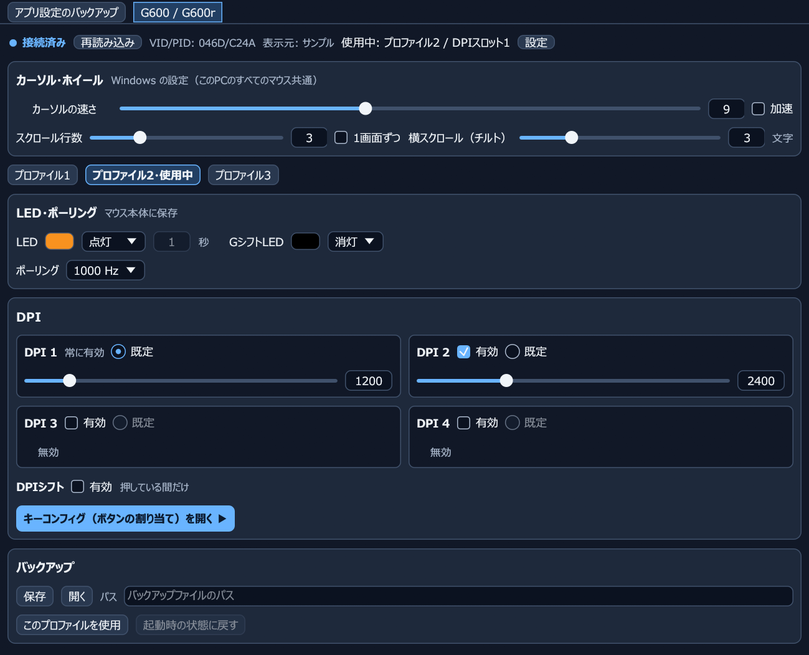
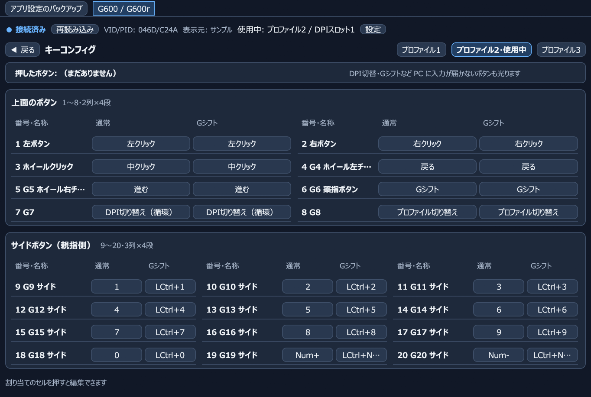
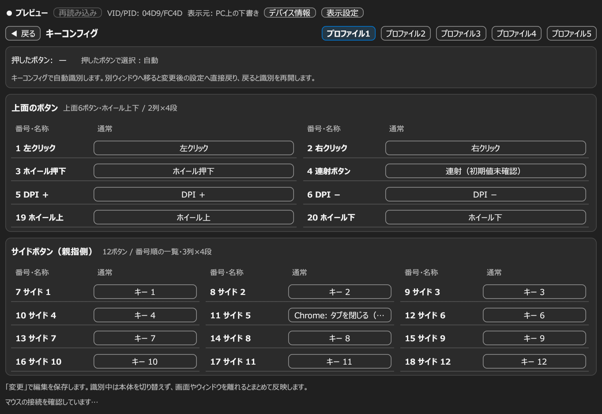
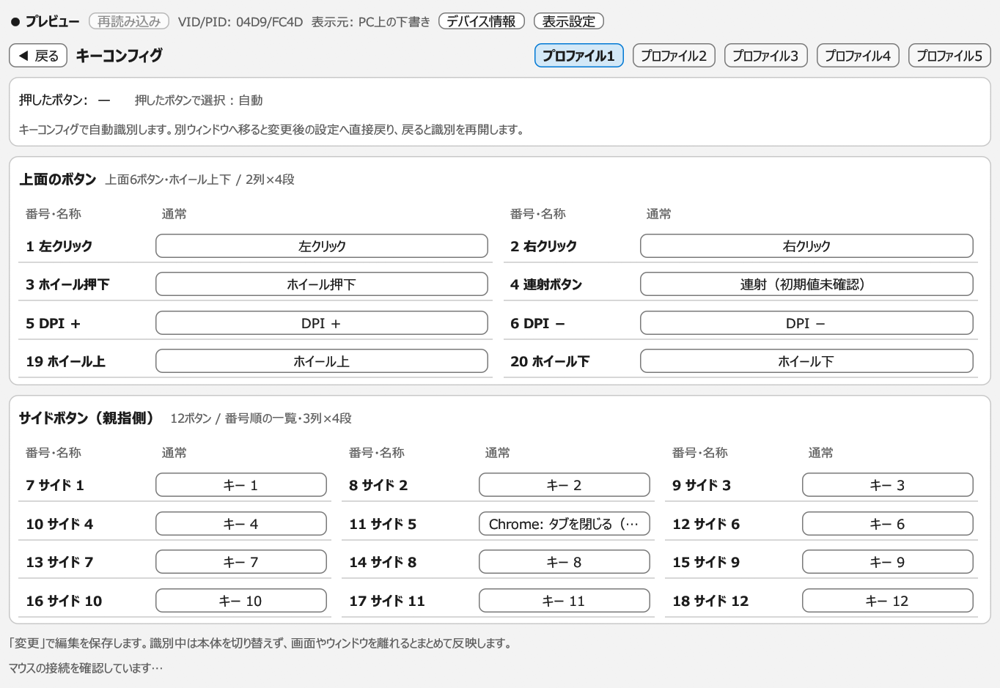

# MMO Mouse Control

**日本語** · [English](docs/readme/README.en.md) · [简体中文](docs/readme/README.zh-Hans.md) · [繁體中文](docs/readme/README.zh-Hant.md) · [한국어](docs/readme/README.ko.md) · [Español](docs/readme/README.es.md) · [Français](docs/readme/README.fr.md) · [Deutsch](docs/readme/README.de.md) · [Português](docs/readme/README.pt.md)

上のリンクからREADMEの言語を選べます。 / Choose a README language above.

Windows 10 / 11（x64）向けの多ボタンマウス設定ツールです。

- ボタン割り当て、DPI、LED、マウス本体のプロファイルを設定
- 接続した対応マウスを認識し、同じウィンドウで機種を切り替え
- マウス設定のバックアップと復元に対応

## インストール

1. [最新リリース](https://github.com/nekomimiyks/mmo-mouse-control/releases/latest)から **MMOMouseControl-Setup-0.12.2-x64.exe** をダウンロードして実行します。
2. 旧ポータブル版から移行する場合は、インストーラーで以前の `MMOMouseControl.exe` があるフォルダーを指定します。
3. 完了画面の後に表示される確認で、今すぐ起動する場合は「はい」、後で起動する場合は「いいえ」を選びます。後からはスタートメニューで開けます。

## 0.12.2の変更

- Windows用インストーラーと旧ポータブル版からの設定移行に対応しました。
- 保存済みのアプリ設定を1つのファイルにまとめてバックアップ・復元できます。

## 設定のバックアップと復元

画面上部の **アプリ設定のバックアップ** を開き、**バックアップを保存** を選びます。M908の保存済みの下書き、登録したショートカット、表示言語が `.mmo-settings` ファイルに保存されます。

復元するには **バックアップから復元** でファイルを選び、**次回起動時に復元** を押してアプリを起動し直します。ファイルに含まれる設定が上書きされます。マウス本体のプロファイルは、各機種の画面にある **バックアップ** を使ってください。

## 表示言語

G600 / G600rの設定画面は、日本語、英語、中国語（簡体字・繁体字）、韓国語、スペイン語、フランス語、ドイツ語、ポルトガル語の9言語に対応しています。

**G600 / G600r → 設定 → 言語**で、G600r画面とアプリ設定のバックアップ画面の言語を切り替えます。**自動 / Windows**を選ぶとWindowsの表示言語に合わせ、対応外の言語では英語を表示します。M908 / Pusat V8の機種別設定画面は日本語です。

## スクリーンショット

0.12.2のサンプル設定を表示しています。

### アプリ設定のバックアップ

### G600rの設定

### G600rのボタン割り当て

### M908のキーコンフィグ

## 操作

| 操作 | 動作 |
| --- | --- |
| 上部の機種名を選ぶ | 両機種を接続しているとき、表示する設定画面を切り替える |
| プロファイルを選ぶ | 編集するプロファイルを切り替える |
| 「キーコンフィグ」を開き、割り当て欄を選ぶ | マウスボタンに割り当てるキーや操作を選ぶ |
| 「バックアップ」の「保存」 | 現在の設定をファイルに保存する |

## 対応機種

| 確認状況 | 機種 |
|---|---|
| 実機で起動・認識・設定読み込みを確認 | Redragon M908 Impact（有線）、Logitech® G600r MMOゲーミングマウス（国内名：Logicool G600r） |
| 公開資料とUSB IDに基づく互換候補 | Monster Pusat V8 MMO（有線、[04D9:FC4D](https://github.com/dokutan/mouse_m908/blob/965d71f957023ebdfe9bc3ea8d2affbfb21c10ff/README.md#supported-mice)）、Logitech G600 MMO Gaming Mouse（[046D:C24A](https://github.com/libratbag/piper/blob/master/data/svgs/svg-lookup.ini)）。このアプリでの実機確認は未実施。 |

独立開発のツールです。製品名は機種の識別に使用しています。商標の帰属は[第三者表記](THIRD_PARTY.md)を参照してください。

## ソースからビルド

WindowsでRust GNUツールチェーン、MinGWのリソースコンパイラ、Cargo依存関係を準備します。PowerShellで **./build.ps1** を実行すると、テストとビルドが走り、**実行ファイル/MMOMouseControl.exe** が生成されます。

インストーラーを作るには、Inno Setupを用意し、ビルド後に **./build-installer.ps1** を実行します。

[配布版に対応するソース v0.12.2](https://github.com/nekomimiyks/mmo-mouse-control/archive/refs/tags/v0.12.2.zip) · [ライセンス](LICENSE) · [プライバシーポリシー](PRIVACY.md)
