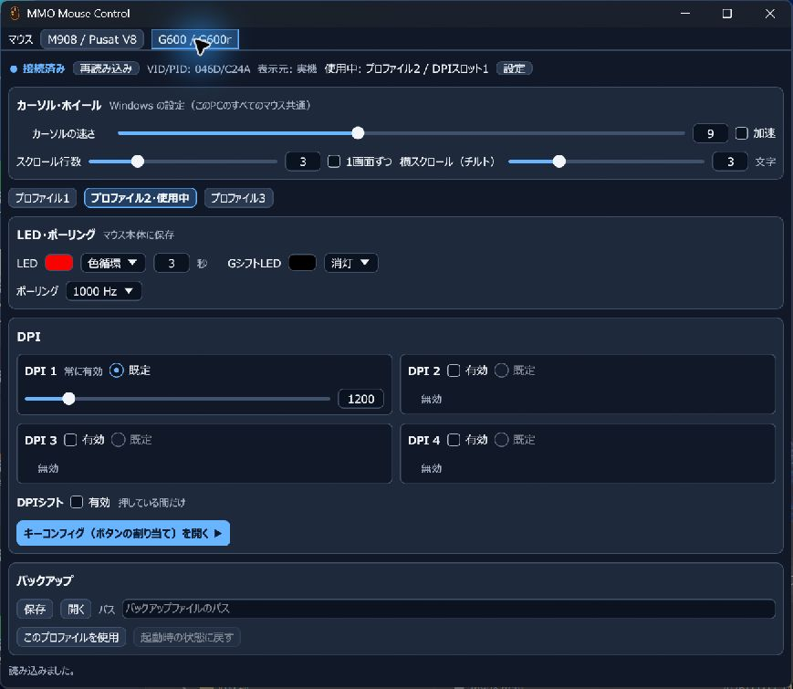

# MMO Mouse Control

Windows 10 / 11（x64）向けの多ボタンマウス設定ツールです。

- ボタン割り当て、DPI、LED、マウス本体のプロファイルを設定
- 接続した対応マウスを認識し、同じウィンドウで機種を切り替え
- マウス設定のバックアップと復元に対応

## ダウンロード

対応マウスをUSBで接続し、[GitHub Releases](https://github.com/nekomimiyks/mmo-mouse-control/releases/latest)から **MMOMouseControl.exe** をダウンロードして起動してください。

## スクリーンショット

| G600rの設定画面 | G600rのボタン割り当て |
| --- | --- |
|  |  |

**M908のキーコンフィグ（サンプルデータでの表示例）**

| ダーク | ライト |
| --- | --- |
|  |  |

## 操作

| 操作 | 動作 |
| --- | --- |
| 上部の機種名を選ぶ | 両機種を接続しているとき、表示する設定画面を切り替える |
| プロファイルを選ぶ | 編集するプロファイルを切り替える |
| 「キーコンフィグ」を開き、割り当て欄を選ぶ | マウスボタンに割り当てるキーや操作を選ぶ |
| 「バックアップ」の「保存」 | 現在の設定をファイルに保存する |

## 対応機種

| 確認状況 | 機種 |
|---|---|
| 実機で起動・認識・設定読み込みを確認 | Redragon M908 Impact（有線）、Logitech® G600r MMOゲーミングマウス（国内名：Logicool G600r） |
| 公開資料とUSB IDに基づく互換候補 | Monster Pusat V8 MMO（有線、[04D9:FC4D](https://github.com/dokutan/mouse_m908/blob/965d71f957023ebdfe9bc3ea8d2affbfb21c10ff/README.md#supported-mice)）、Logitech G600 MMO Gaming Mouse（[046D:C24A](https://github.com/libratbag/piper/blob/master/data/svgs/svg-lookup.ini)）。このアプリでの実機確認は未実施。 |

独立開発のツールです。製品名は機種の識別に使用しています。商標の帰属は[第三者表記](THIRD_PARTY.md)を参照してください。

## ソースからビルド

WindowsでRust GNUツールチェーン、MinGWのリソースコンパイラ、Cargo依存関係を準備します。PowerShellで **./build.ps1** を実行すると、テストとビルドが走り、**実行ファイル/MMOMouseControl.exe** が生成されます。

[配布版に対応するソース v0.12.1](https://github.com/nekomimiyks/mmo-mouse-control/archive/refs/tags/v0.12.1.zip) · [ライセンス](LICENSE) · [プライバシーポリシー](PRIVACY.md)
