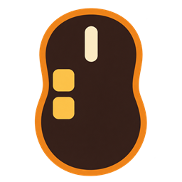

# MMO Mouse Control

Configure button assignments, DPI, lighting, and onboard profiles for supported MMO mice on Windows. The app detects connected mice and lets you switch between them in one window.

Supported mice are the wired Redragon M908 Impact, Monster Pusat V8 MMO, and Logitech G600 / G600r.

## Download

Download `MMOMouseControl.exe` from [Releases](../../releases/latest), connect a supported mouse, and run it. The app can also back up and restore mouse settings.

## Screenshots

## Build

Run `./build.ps1` on Windows with the Rust GNU toolchain and Cargo dependencies available offline. The script runs the tests and produces `実行ファイル/MMOMouseControl.exe`. Use `./build.ps1 -TestOnly` to run only the tests.

To build the Microsoft Store package, run `./build-msix.ps1` after the app build. It requires Windows SDK MakeAppx.

## License

GPL-3.0-or-later. See [LICENSE](LICENSE) and [third-party notices](THIRD_PARTY.md).
