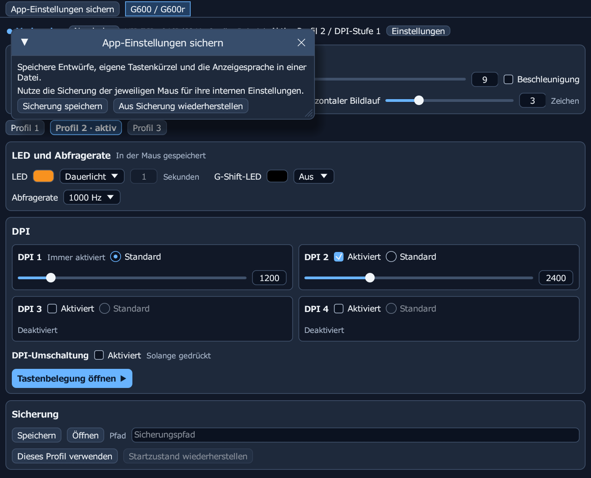
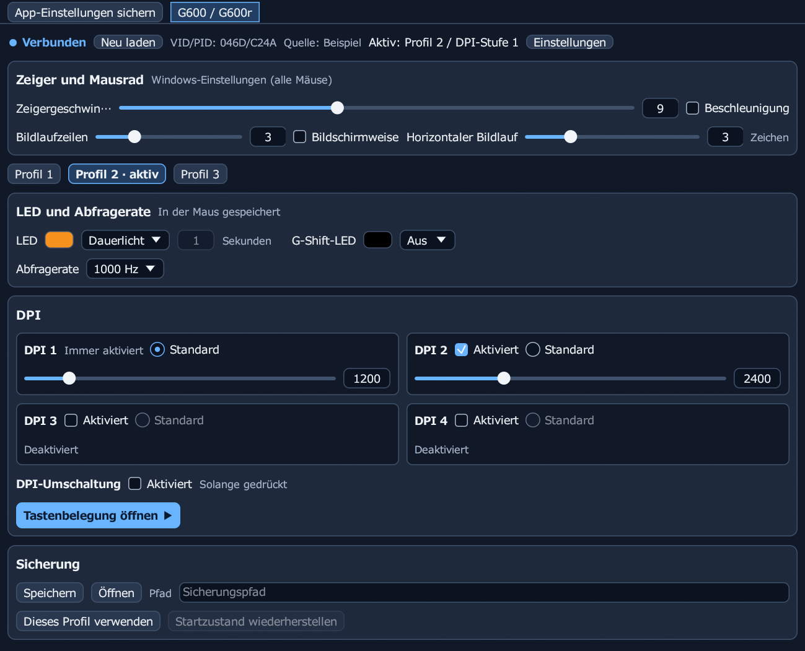
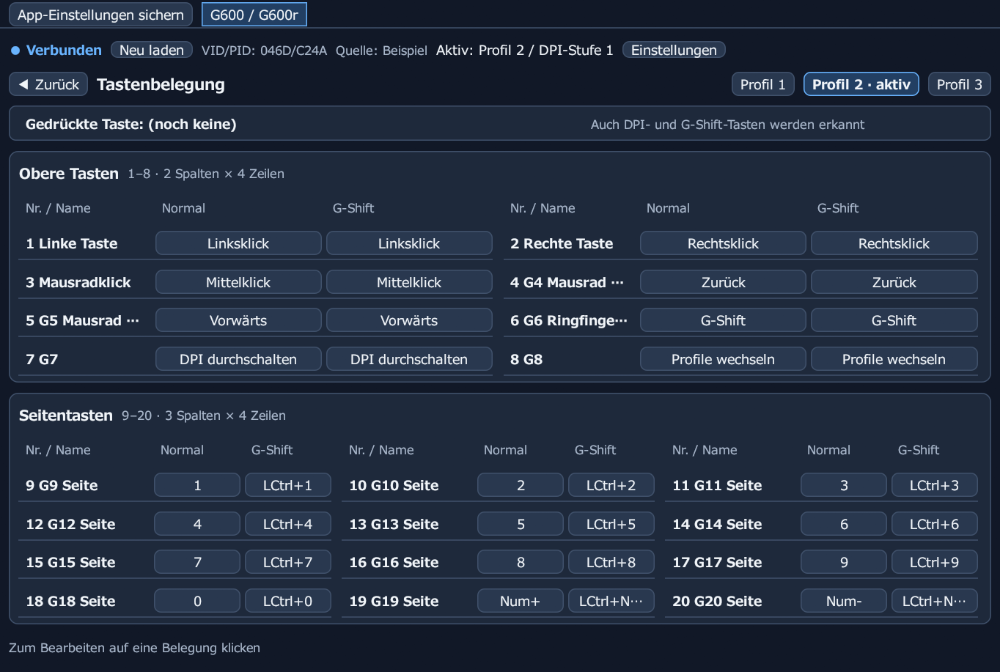

# MMO Mouse Control

[日本語](../../README.md) · [English](README.en.md) · [简体中文](README.zh-Hans.md) · [繁體中文](README.zh-Hant.md) · [한국어](README.ko.md) · [Español](README.es.md) · [Français](README.fr.md) · **Deutsch** · [Português](README.pt.md)

Ein Tool für Windows 10/11 (x64) zur Konfiguration von Mäusen mit mehreren Tasten. Passe Tastenbelegung, DPI, Beleuchtung und auf der Maus gespeicherte Profile an. Einstellungen lassen sich sichern und wiederherstellen.

## Installation

Lade **MMOMouseControl-Setup-0.12.2-x64.exe** über [GitHub Releases](https://github.com/nekomimiyks/mmo-mouse-control/releases/latest) herunter und führe die Datei aus. Falls du die portable Version genutzt hast, wähle ihren Ordner im Setup. Wähle am Ende **Ja** zum Starten oder **Nein** zum Beenden.

## Neu in 0.12.2

Windows-Installationsprogramm, Übernahme portabler Einstellungen und eine Sicherungsdatei für App-Einstellungen.

## Einstellungen sichern und wiederherstellen

Wähle **App-Einstellungen sichern → Sicherung speichern**, um Entwürfe, eigene Tastenkürzel und die Anzeigesprache als `.mmo-settings` zu speichern. Wähle **Aus Sicherung wiederherstellen**, bestätige und starte die App neu. Nutze für interne Profile die Sicherungsfunktion der jeweiligen Maus.

## Kompatibilität

- An der Hardware getestet: kabelgebundene Redragon M908 Impact und Logitech G600r (in Japan Logicool G600r).
- Voraussichtlich kompatibel laut veröffentlichten USB-IDs: kabelgebundene [Monster Pusat V8 MMO](https://github.com/dokutan/mouse_m908/blob/965d71f957023ebdfe9bc3ea8d2affbfb21c10ff/README.md#supported-mice) und [Logitech G600](https://github.com/libratbag/piper/blob/master/data/svgs/svg-lookup.ini). Diese Modelle wurden mit dieser App noch nicht getestet.

## Anzeigesprachen

Japanisch, Englisch, vereinfachtes Chinesisch, traditionelles Chinesisch, Koreanisch, Spanisch, Französisch, Deutsch und Portugiesisch.

Öffne **G600 / G600r → Einstellungen → Sprache**. **Automatisch / Windows** verwendet die Windows-Anzeigesprache und wechselt zu Englisch, wenn diese Sprache nicht verfügbar ist. Die Einstellung gilt für die G600 / G600r-Ansicht. Die M908 / Pusat V8-Ansicht ist auf Japanisch.

## Screenshots

Die Screenshots zeigen Beispieleinstellungen.

### App-Einstellungen sichern

### G600r-Einstellungen

### G600r-Tastenbelegung

## Aus dem Quellcode bauen

Installiere unter Windows die Rust-GNU-Toolchain, den MinGW-Ressourcencompiler und die Cargo-Abhängigkeiten. Führe **./build.ps1** in PowerShell aus.

[Lizenz](../../LICENSE) · [Drittanbieterhinweise](../../THIRD_PARTY.md) · [Datenschutzerklärung](../../PRIVACY.md)
