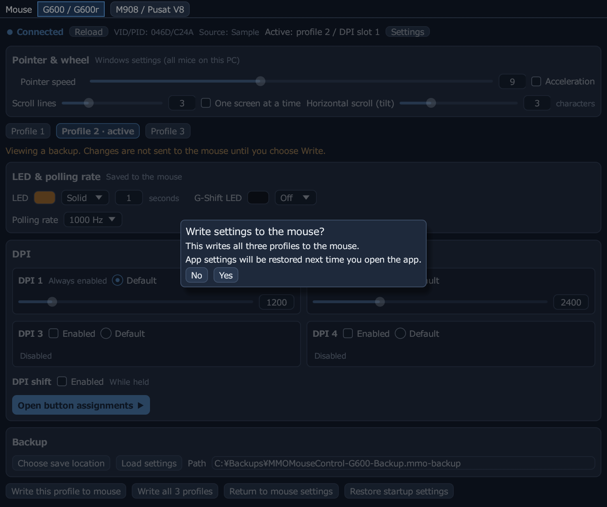
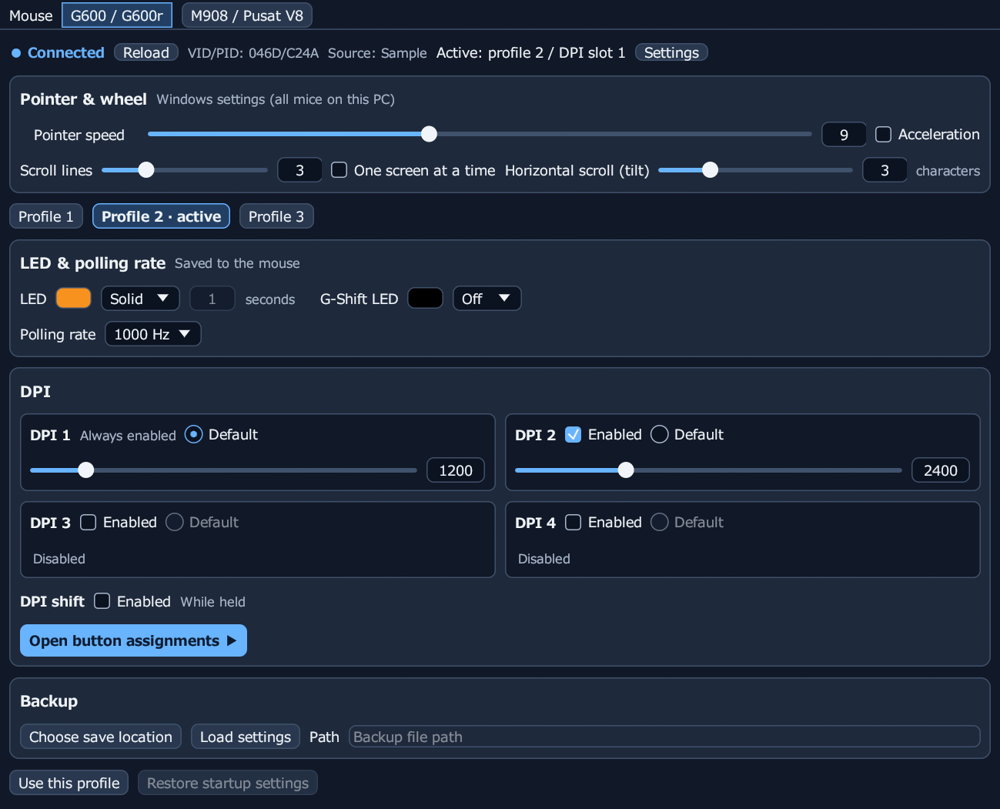
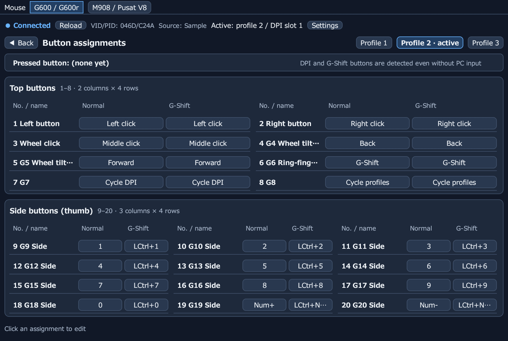

# MMO Mouse Control

[日本語](../../README.md) · **English** · [简体中文](README.zh-Hans.md) · [繁體中文](README.zh-Hant.md) · [한국어](README.ko.md) · [Español](README.es.md) · [Français](README.fr.md) · [Deutsch](README.de.md) · [Português](README.pt.md)

A Windows 10/11 (x64) utility for configuring multi-button mice. Set button assignments, DPI, lighting, and onboard profiles, and back up or restore settings.

## Installation

Download **MMOMouseControl-Setup-0.12.3-x64.exe** from [GitHub Releases](https://github.com/nekomimiyks/mmo-mouse-control/releases/latest) and run it. If you used the portable version, select its folder during setup. At the end, choose **Yes** to start now or **No** to close setup.

When updating, setup closes the running installed copy before replacing it. If the app is waiting for your response, finish the prompt and run setup again.

## What’s new in 0.12.3

G600 is selected at startup when both mice are connected. Each mouse has one backup file for its profiles and app preferences.

## Back up and restore settings

In **Backup**, choose **Choose save location** to save a `.mmo-backup` file. Choose **Load settings** to open it. Select **Yes** to write the profiles to the connected mouse or **No** to preview them. App preferences take effect the next time you open the app.

## Compatibility

- Tested on hardware: wired Redragon M908 Impact and Logitech G600r (Logicool G600r in Japan).
- Likely compatible based on published USB IDs: wired [Monster Pusat V8 MMO](https://github.com/dokutan/mouse_m908/blob/965d71f957023ebdfe9bc3ea8d2affbfb21c10ff/README.md#supported-mice) and [Logitech G600](https://github.com/libratbag/piper/blob/master/data/svgs/svg-lookup.ini). These models have not been tested with this app.

## App languages

Japanese, English, Simplified Chinese, Traditional Chinese, Korean, Spanish, French, German, and Portuguese.

Open **G600 / G600r → Settings → Language** to choose a language. **Automatic / Windows** uses the Windows display language and falls back to English when the language is unavailable. This setting applies to the G600 / G600r screen. The M908 / Pusat V8 screen is in Japanese.

## Screenshots

Screenshots show sample settings.

### Confirming a backup restore

### G600r settings

### G600r button assignments

## Build from source

On Windows, prepare the Rust GNU toolchain, the MinGW resource compiler, and Cargo dependencies. Run **./build.ps1** in PowerShell.

[License](../../LICENSE) · [Third-party notices](../../THIRD_PARTY.md) · [Privacy policy](../../PRIVACY.md)
