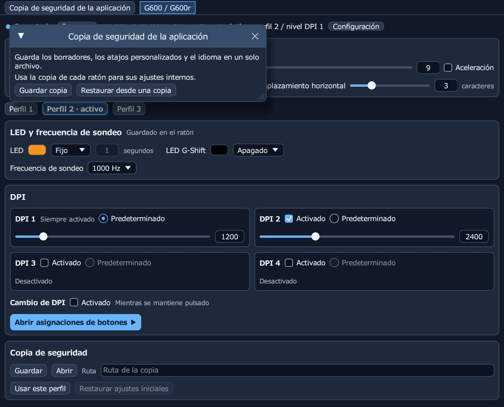
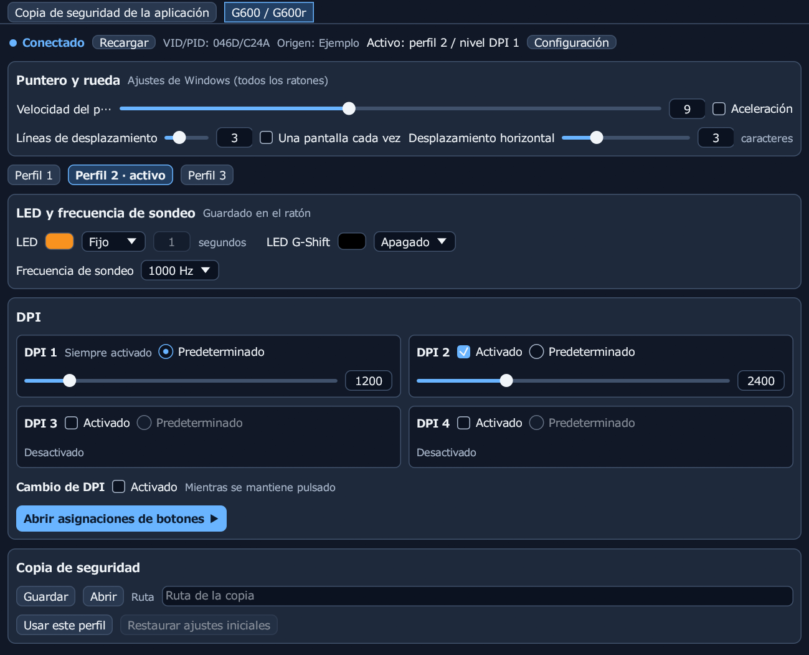
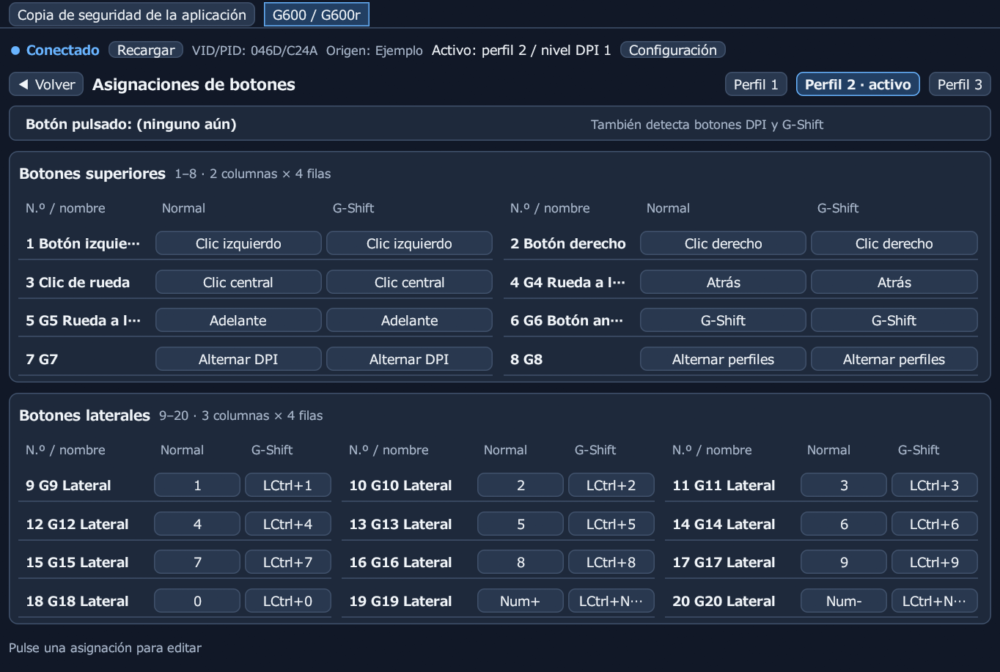

# MMO Mouse Control

[日本語](../../README.md) · [English](README.en.md) · [简体中文](README.zh-Hans.md) · [繁體中文](README.zh-Hant.md) · [한국어](README.ko.md) · **Español** · [Français](README.fr.md) · [Deutsch](README.de.md) · [Português](README.pt.md)

Herramienta para Windows 10/11 (x64) que permite configurar ratones con varios botones. Cambia las asignaciones de botones, los DPI, la iluminación y los perfiles del ratón. También permite guardar y restaurar la configuración.

## Instalación

Descarga **MMOMouseControl-Setup-0.12.2-x64.exe** desde [GitHub Releases](https://github.com/nekomimiyks/mmo-mouse-control/releases/latest) y ejecútalo. Si usabas la versión portátil, selecciona su carpeta durante la instalación. Al terminar, elige **Sí** para abrir la aplicación o **No** para salir.

## Novedades en 0.12.2

Instalador de Windows, migración de ajustes de la versión portátil y copia de los ajustes en un solo archivo.

## Copia de seguridad y restauración

Abre **Copia de seguridad de la aplicación → Guardar copia** para guardar borradores, atajos personalizados e idioma en un archivo `.mmo-settings`. Para restaurar, elige **Restaurar desde una copia**, confirma y vuelve a abrir la aplicación. Para los perfiles internos, usa la copia de cada ratón.

## Compatibilidad

- Probados con el dispositivo: Redragon M908 Impact con cable y Logitech G600r (Logicool G600r en Japón).
- Compatibilidad prevista según los ID USB publicados: [Monster Pusat V8 MMO](https://github.com/dokutan/mouse_m908/blob/965d71f957023ebdfe9bc3ea8d2affbfb21c10ff/README.md#supported-mice) con cable y [Logitech G600](https://github.com/libratbag/piper/blob/master/data/svgs/svg-lookup.ini). Estos modelos aún no se han probado con esta aplicación.

## Idiomas de la aplicación

Japonés, inglés, chino simplificado, chino tradicional, coreano, español, francés, alemán y portugués.

Abre **G600 / G600r → Configuración → Idioma**. **Automático / Windows** usa el idioma de pantalla de Windows y recurre al inglés si ese idioma no está disponible. Este ajuste se aplica a la pantalla G600 / G600r. La pantalla M908 / Pusat V8 está en japonés.

## Capturas de pantalla

Las capturas muestran ajustes de ejemplo.

### Copia de seguridad de la aplicación

### Configuración del G600r

### Asignación de botones del G600r

## Compilar desde el código fuente

En Windows, prepara la cadena de herramientas Rust GNU, el compilador de recursos de MinGW y las dependencias de Cargo. Ejecuta **./build.ps1** en PowerShell.

[Licencia](../../LICENSE) · [Avisos de terceros](../../THIRD_PARTY.md) · [Política de privacidad](../../PRIVACY.md)
