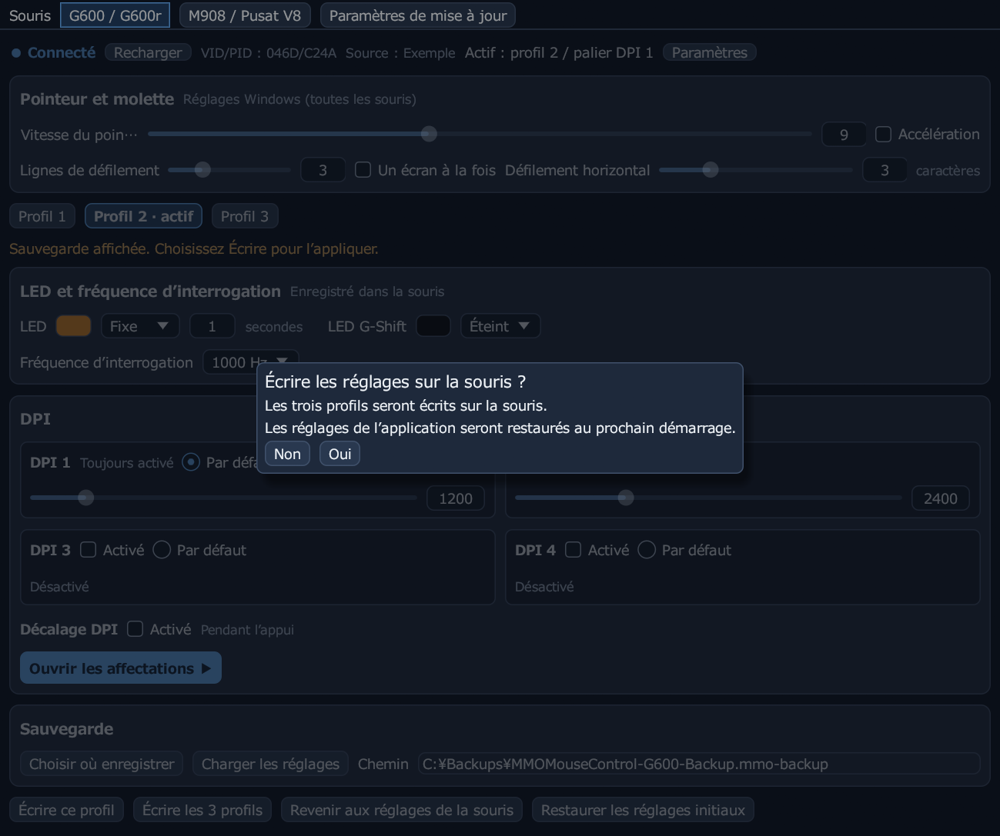
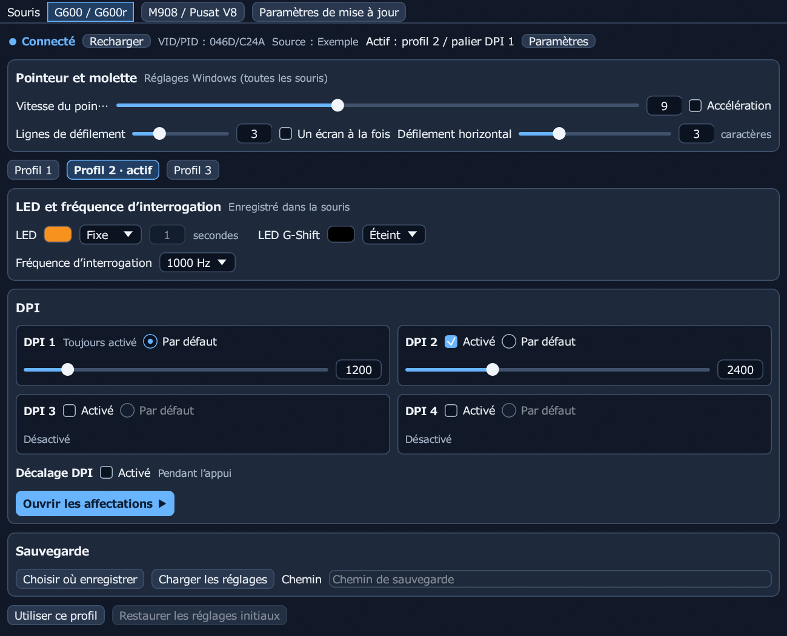
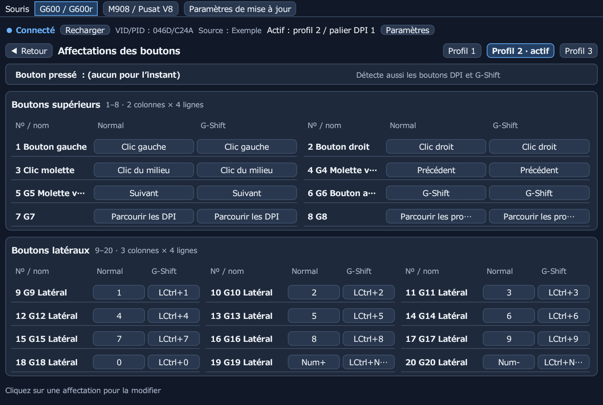

# MMO Mouse Control

[日本語](../../README.md) · [English](README.en.md) · [简体中文](README.zh-Hans.md) · [繁體中文](README.zh-Hant.md) · [한국어](README.ko.md) · [Español](README.es.md) · **Français** · [Deutsch](README.de.md) · [Português](README.pt.md)

Utilitaire pour Windows 10/11 (x64) permettant de configurer les souris à plusieurs boutons. Réglez les affectations de boutons, les DPI, l’éclairage et les profils enregistrés dans la souris. Vous pouvez aussi sauvegarder et restaurer les réglages.

## Installation

Téléchargez **MMOMouseControl-Setup-0.12.4-x64.exe** depuis [GitHub Releases](https://github.com/nekomimiyks/mmo-mouse-control/releases/latest) et exécutez-le. Si vous utilisiez la version portable, sélectionnez son dossier pendant l’installation. À la fin, choisissez **Oui** pour ouvrir l’application ou **Non** pour quitter.

Lors d’une mise à jour, le programme ferme l’application installée avant de la remplacer. Si l’application attend une confirmation, répondez puis relancez l’installation.

## Nouveautés de la version 0.12.4

L’installation crée un raccourci sur le bureau. Dans l’édition GitHub, activez la vérification au démarrage dans **Paramètres de mise à jour**. Elle est désactivée par défaut. Microsoft Store gère les mises à jour de son édition. Lorsqu’une nouvelle version est disponible, choisissez **Mettre à jour** pour télécharger et lancer le programme d’installation vérifié.

## Sauvegarder et restaurer les réglages

Dans **Sauvegarde**, utilisez **Choisir où enregistrer** pour créer un fichier `.mmo-backup`. Ouvrez-le avec **Charger les réglages**. Choisissez **Oui** pour écrire les profils sur la souris ou **Non** pour les afficher à l’écran. Les préférences s’appliquent au prochain démarrage.

## Compatibilité

- Testé sur les appareils suivants : Redragon M908 Impact filaire et Logitech G600r (Logicool G600r au Japon).
- Compatibilité probable d’après les identifiants USB publiés : [Monster Pusat V8 MMO](https://github.com/dokutan/mouse_m908/blob/965d71f957023ebdfe9bc3ea8d2affbfb21c10ff/README.md#supported-mice) filaire et [Logitech G600](https://github.com/libratbag/piper/blob/master/data/svgs/svg-lookup.ini). Ces modèles n’ont pas encore été testés avec cette application.

## Langues de l’application

Japonais, anglais, chinois simplifié, chinois traditionnel, coréen, espagnol, français, allemand et portugais.

Ouvrez **G600 / G600r → Paramètres → Langue**. **Automatique / Windows** utilise la langue d’affichage de Windows et passe à l’anglais si elle n’est pas disponible. Ce réglage s’applique à l’écran G600 / G600r. L’écran M908 / Pusat V8 est en japonais.

## Captures d’écran

Les captures illustrent des réglages d’exemple.

### Confirmation de la restauration

### Réglages de la G600r

### Affectation des boutons de la G600r

## Compiler depuis les sources

Sous Windows, préparez la chaîne d’outils Rust GNU, le compilateur de ressources MinGW et les dépendances Cargo. Exécutez **./build.ps1** dans PowerShell.

[Licence](../../LICENSE) · [Mentions de tiers](../../THIRD_PARTY.md) · [Politique de confidentialité](../../PRIVACY.md)
