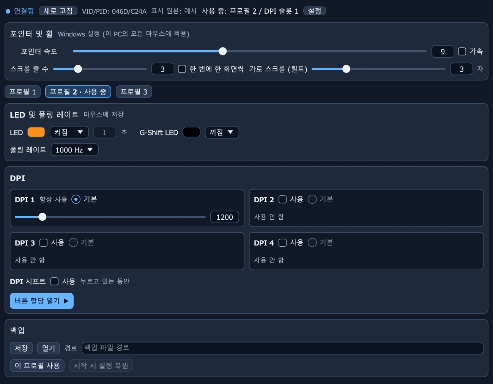
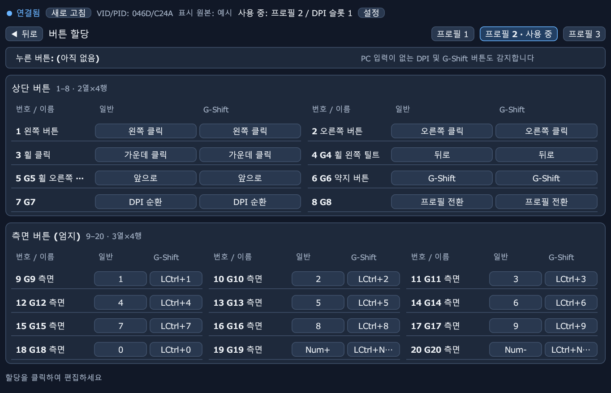

# MMO Mouse Control

[日本語](../../README.md) · [English](README.en.md) · [简体中文](README.zh-Hans.md) · [繁體中文](README.zh-Hant.md) · **한국어** · [Español](README.es.md) · [Français](README.fr.md) · [Deutsch](README.de.md) · [Português](README.pt.md)

Windows 10/11(x64)용 다중 버튼 마우스 설정 도구입니다. 버튼 할당, DPI, 조명, 온보드 프로필을 설정하고 설정을 백업하거나 복원할 수 있습니다.

## 다운로드

지원되는 마우스를 USB로 연결하고 [GitHub Releases](https://github.com/nekomimiyks/mmo-mouse-control/releases/latest)에서 **MMOMouseControl.exe**를 내려받아 실행하세요.

## 호환 모델

- 실기기에서 확인: 유선 Redragon M908 Impact, Logitech G600r(일본 모델명 Logicool G600r).
- 공개된 USB ID를 기준으로 유선 [Monster Pusat V8 MMO](https://github.com/dokutan/mouse_m908/blob/965d71f957023ebdfe9bc3ea8d2affbfb21c10ff/README.md#supported-mice)와 [Logitech G600](https://github.com/libratbag/piper/blob/master/data/svgs/svg-lookup.ini)도 호환될 것으로 예상됩니다. 이 앱으로 해당 모델의 실기기를 테스트하지는 않았습니다.

## 앱 표시 언어

일본어, 영어, 중국어 간체, 중국어 번체, 한국어, 스페인어, 프랑스어, 독일어, 포르투갈어.

**G600 / G600r → 설정 → 언어**에서 표시 언어를 선택합니다. **자동 / Windows**는 Windows 표시 언어를 사용하며, 해당 언어가 지원되지 않으면 영어를 사용합니다. 이 설정은 G600 / G600r 화면에 적용됩니다. M908 / Pusat V8 화면은 일본어로 표시됩니다.

## 스크린샷

스크린샷은 예시 설정을 보여 줍니다.

| G600r 설정 화면 | G600r 버튼 할당 |
| --- | --- |
|  |  |

## 소스에서 빌드

Windows에서 Rust GNU 도구 체인, MinGW 리소스 컴파일러, Cargo 종속성을 준비하고 PowerShell에서 **./build.ps1**을 실행하세요.

[라이선스](../../LICENSE) · [타사 고지](../../THIRD_PARTY.md) · [개인정보 처리방침](../../PRIVACY.md)
