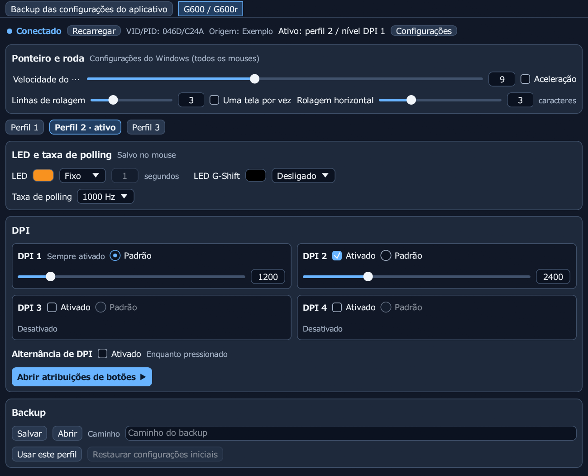

# MMO Mouse Control

[日本語](../../README.md) · [English](README.en.md) · [简体中文](README.zh-Hans.md) · [繁體中文](README.zh-Hant.md) · [한국어](README.ko.md) · [Español](README.es.md) · [Français](README.fr.md) · [Deutsch](README.de.md) · **Português**

Ferramenta para Windows 10/11 (x64) para configurar mouses com vários botões. Ajuste a atribuição de botões, o DPI, a iluminação e os perfis salvos no mouse. Também é possível fazer backup e restaurar as configurações.

## Instalação

Baixe **MMOMouseControl-Setup-0.12.2-x64.exe** em [GitHub Releases](https://github.com/nekomimiyks/mmo-mouse-control/releases/latest) e execute o arquivo. Se usava a versão portátil, selecione a pasta dela durante a instalação. No final, escolha **Sim** para abrir o aplicativo ou **Não** para sair.

## Novidades da versão 0.12.2

Instalador para Windows, migração da versão portátil e backup das configurações em um só arquivo.

## Fazer backup e restaurar configurações

Abra **Backup das configurações do aplicativo → Salvar backup** para exportar rascunhos, atalhos personalizados e idioma em um arquivo `.mmo-settings`. Escolha **Restaurar do backup**, confirme e reabra o aplicativo. Use o backup de cada mouse para os perfis internos.

## Compatibilidade

- Testados com os dispositivos: Redragon M908 Impact com fio e Logitech G600r (Logicool G600r no Japão).
- Compatibilidade esperada com base nos IDs USB publicados: [Monster Pusat V8 MMO](https://github.com/dokutan/mouse_m908/blob/965d71f957023ebdfe9bc3ea8d2affbfb21c10ff/README.md#supported-mice) com fio e [Logitech G600](https://github.com/libratbag/piper/blob/master/data/svgs/svg-lookup.ini). Esses modelos ainda não foram testados com este aplicativo.

## Idiomas do aplicativo

Japonês, inglês, chinês simplificado, chinês tradicional, coreano, espanhol, francês, alemão e português.

Abra **G600 / G600r → Configurações → Idioma**. **Automático / Windows** usa o idioma de exibição do Windows e usa o inglês se esse idioma não estiver disponível. Essa configuração se aplica à tela do G600 / G600r. A tela do M908 / Pusat V8 está em japonês.

## Capturas de tela

As capturas mostram configurações de exemplo.

### Backup das configurações do aplicativo

### Configurações do G600r

### Atribuição de botões do G600r

## Compilar a partir do código-fonte

No Windows, prepare a cadeia de ferramentas Rust GNU, o compilador de recursos do MinGW e as dependências do Cargo. Execute **./build.ps1** no PowerShell.

[Licença](../../LICENSE) · [Avisos de terceiros](../../THIRD_PARTY.md) · [Política de privacidade](../../PRIVACY.md)
