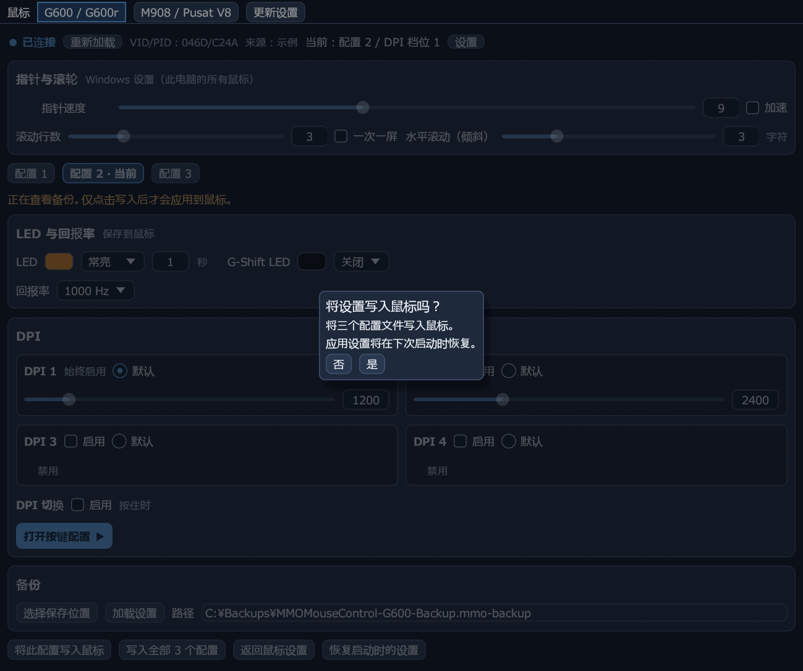
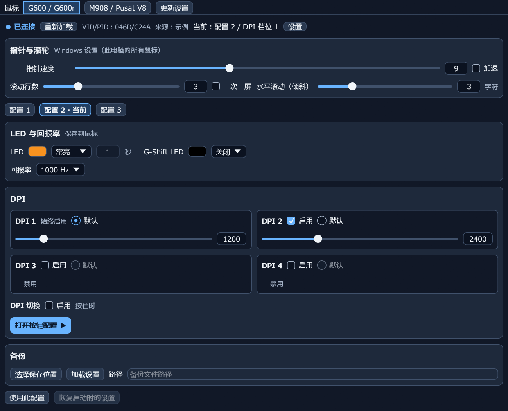
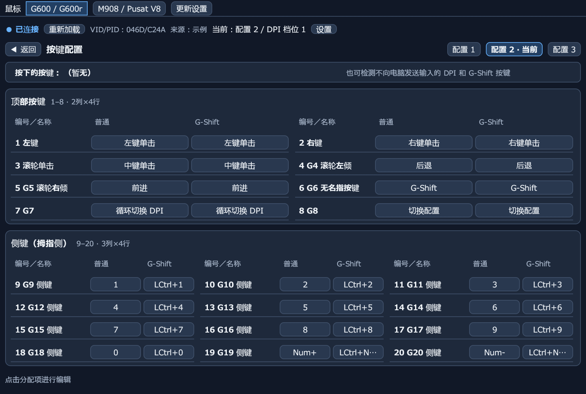

# MMO Mouse Control

[日本語](../../README.md) · [English](README.en.md) · **简体中文** · [繁體中文](README.zh-Hant.md) · [한국어](README.ko.md) · [Español](README.es.md) · [Français](README.fr.md) · [Deutsch](README.de.md) · [Português](README.pt.md)

适用于 Windows 10/11（x64）的多键鼠标配置工具。可以设置按键分配、DPI、灯光和板载配置文件，也可以备份和恢复设置。

## 安装

从 [GitHub Releases](https://github.com/nekomimiyks/mmo-mouse-control/releases/latest) 下载并运行 **MMOMouseControl-Setup-0.12.4-x64.exe**。如果使用过便携版，请在安装时选择其文件夹。安装结束后选择 **是** 立即启动，选择 **否** 退出安装。

更新时，安装程序会先关闭正在运行的已安装版本。如果应用正在等待确认，请完成确认后重新运行安装程序。

## 0.12.4 更新内容

安装时创建桌面快捷方式。GitHub 版可在 **更新设置** 中开启启动时检查更新，默认关闭。商店版由 Microsoft Store 管理更新。 发现新版本时，选择 **更新** 即可下载并启动经过验证的安装程序。

## 备份和恢复设置

在 **备份** 中选择 **选择保存位置**，保存 `.mmo-backup` 文件。使用 **加载设置** 打开文件。选择 **是** 将配置写入鼠标，选择 **否** 仅在屏幕上查看。应用偏好设置会在下次启动时生效。

## 兼容性

- 已在实物上验证：有线 Redragon M908 Impact 和 Logitech G600r（日本名称为 Logicool G600r）。
- 根据公开的 USB ID，预计兼容有线 [Monster Pusat V8 MMO](https://github.com/dokutan/mouse_m908/blob/965d71f957023ebdfe9bc3ea8d2affbfb21c10ff/README.md#supported-mice) 和 [Logitech G600](https://github.com/libratbag/piper/blob/master/data/svgs/svg-lookup.ini)。本应用尚未在这些型号的实物上验证。

## 应用语言

日语、英语、简体中文、繁体中文、韩语、西班牙语、法语、德语和葡萄牙语。

打开 **G600 / G600r → 设置 → 语言** 选择显示语言。选择 **自动 / Windows** 时跟随 Windows 显示语言，若不支持该语言则使用英语。此设置适用于 G600 / G600r 界面。M908 / Pusat V8 界面使用日语。

## 屏幕截图

截图使用示例设置。

### 确认恢复备份

### G600r 设置

### G600r 按键分配

## 从源代码构建

在 Windows 上准备 Rust GNU 工具链、MinGW 资源编译器和 Cargo 依赖项。在 PowerShell 中运行 **./build.ps1**。

[许可证](../../LICENSE) · [第三方声明](../../THIRD_PARTY.md) · [隐私政策](../../PRIVACY.md)
