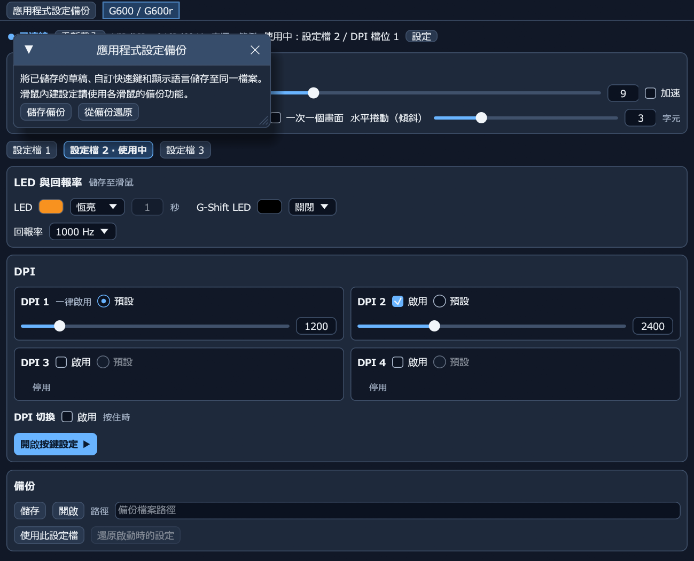
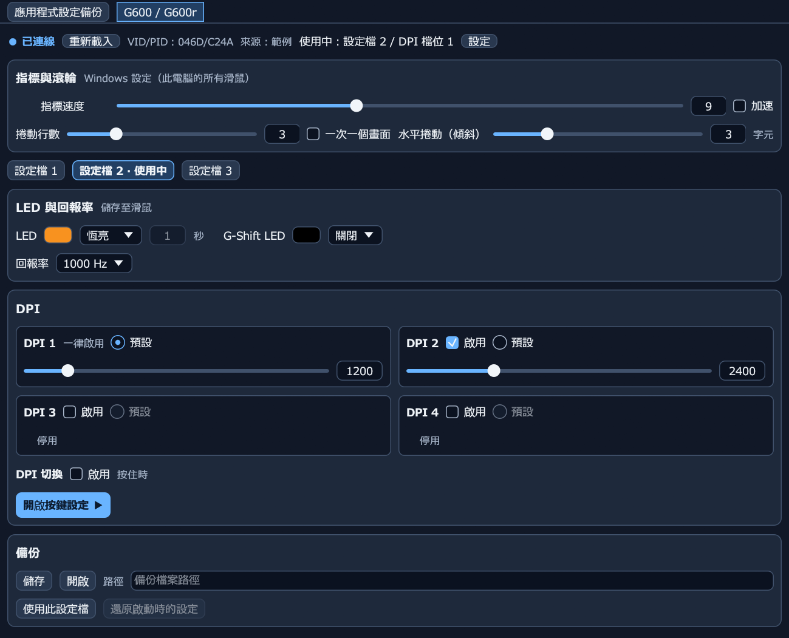
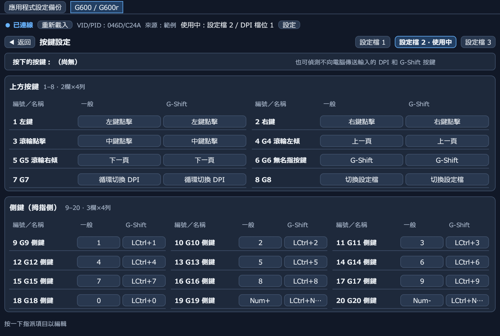

# MMO Mouse Control

[日本語](../../README.md) · [English](README.en.md) · [简体中文](README.zh-Hans.md) · **繁體中文** · [한국어](README.ko.md) · [Español](README.es.md) · [Français](README.fr.md) · [Deutsch](README.de.md) · [Português](README.pt.md)

適用於 Windows 10/11（x64）的多按鍵滑鼠設定工具。可變更按鍵指派、DPI、燈光與內建設定檔，也可備份與還原設定。

## 安裝

從 [GitHub Releases](https://github.com/nekomimiyks/mmo-mouse-control/releases/latest) 下載並執行 **MMOMouseControl-Setup-0.12.2-x64.exe**。如果曾使用可攜版，請在安裝時選取其資料夾。安裝完成後選擇 **是** 立即啟動，選擇 **否** 結束安裝。

## 0.12.2 更新內容

新增 Windows 安裝程式、可攜版設定移轉，以及應用程式設定備份。

## 備份和還原設定

開啟 **應用程式設定備份 → 儲存備份**，將草稿、自訂快速鍵和顯示語言儲存到 `.mmo-settings` 檔案。透過 **從備份還原** 選取檔案並確認，之後重新啟動應用程式。內建設定檔請使用各滑鼠的備份功能。

## 相容性

- 已用實機驗證：有線 Redragon M908 Impact 與 Logitech G600r（日本名稱為 Logicool G600r）。
- 根據公開的 USB ID，有線 [Monster Pusat V8 MMO](https://github.com/dokutan/mouse_m908/blob/965d71f957023ebdfe9bc3ea8d2affbfb21c10ff/README.md#supported-mice) 與 [Logitech G600](https://github.com/libratbag/piper/blob/master/data/svgs/svg-lookup.ini) 預期相容。本應用程式尚未在這些型號的實機上驗證。

## 應用程式語言

日文、英文、簡體中文、繁體中文、韓文、西班牙文、法文、德文與葡萄牙文。

開啟 **G600 / G600r → 設定 → 語言**，選擇顯示語言。選擇 **自動 / Windows** 時，會依照 Windows 的顯示語言，遇到未支援的語言則使用英文。此設定適用於 G600 / G600r 畫面。M908 / Pusat V8 畫面使用日文。

## 螢幕擷取畫面

螢幕擷取畫面使用範例設定。

### 應用程式設定備份

### G600r 設定

### G600r 按鍵指派

## 從原始碼建置

在 Windows 上準備 Rust GNU 工具鏈、MinGW 資源編譯器與 Cargo 相依套件。在 PowerShell 執行 **./build.ps1**。

[授權條款](../../LICENSE) · [第三方聲明](../../THIRD_PARTY.md) · [隱私權政策](../../PRIVACY.md)
